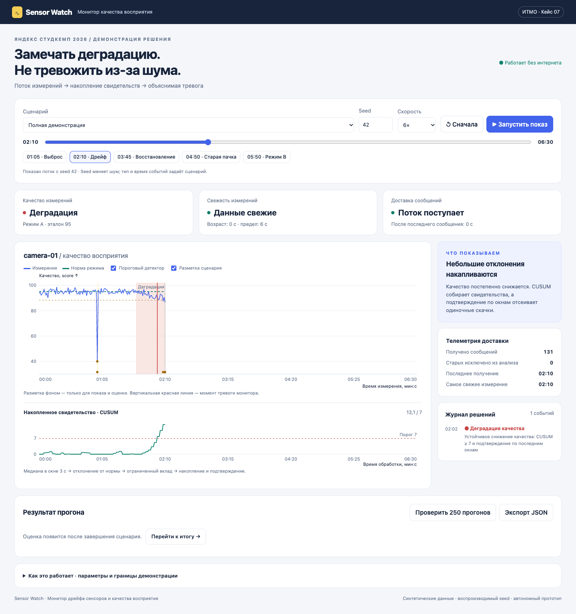

# YandexStudCamp2026

**Sensor Watch** — автономная демонстрация решения кейса № 7 «Монитор дрейфа сенсоров и качества восприятия» для Яндекс Студкемпа 2026.

Прототип обрабатывает синтетическую телеметрию, обнаруживает устойчивое ухудшение качества и отсутствие свежих измерений, ведёт журнал инцидентов и сравнивает результат с простым пороговым детектором.



## Запуск

Скачайте репозиторий и откройте [`demo/Демонстрация.html`](demo/Демонстрация.html) в браузере. Этот файл самодостаточен: интернет, сервер и установка зависимостей не нужны. Предварительный просмотр HTML непосредственно на странице GitHub не запускает приложение — файл нужно скачать.

Выберите сценарий и нажмите **«Запустить показ»**. Можно менять скорость и seed, перемещаться по времени или переходить к ключевым событиям кнопками.

При желании запустите локальный сервер из корня репозитория:

```sh
python3 -m http.server 8000
```

Затем откройте `http://localhost:8000/demo/Демонстрация.html`.

## Сценарии

- Одиночный выброс без устойчивой неисправности.
- Плавная деградация с восстановлением.
- Пропуск данных и доставка накопленной пачки старых измерений.
- Допустимая смена режима.
- Полная последовательность событий для защиты.

Seed меняет случайный шум. Типы и время событий определяются сценарием. Одинаковый seed воспроизводит одинаковые данные.

## Алгоритм

- Обработка измерений по времени доставки с разделением времени измерения и получения.
- Медиана неперекрывающихся окон 3 с, ожидание опозданий 2 с. Остаток каждого измерения нормируется эталоном его режима, медиана стандартизуется по числу значений в окне.
- Ограниченный CUSUM с подтверждением открытия инцидента по последним окнам. Смена режима не сбрасывает накопление и не закрывает открытый инцидент.
- Подтверждение восстановления по пяти нормальным окнам, затем сброс накопления.
- Независимый таймер свежести: старые сообщения не означают восстановление потока.
- Отдельные заданные эталоны для известных режимов. Неизвестный режим отмечается в журнале, качество в нём не оценивается.
- Отдельный инцидент, если в окне не меньше 50% измерений с невалидными флагами.
- Удаление дублей в пределах окна 120 с: память монитора не растёт с длиной потока.

Разметка не передаётся детектору. Интерфейс воспроизводит результат последовательного прохода по потоку; при расчёте детектор не получает будущие сообщения.

## Проверка и сборка

Нужен Node.js 18 или новее. Сторонние пакеты не требуются.

```sh
node --test demo/engine.test.cjs
node demo/build.cjs
```

Сборка встраивает движок в интерфейс и обновляет `demo/Демонстрация.html`.

В интерфейсе доступна пакетная проверка: 5 сценариев × 50 seed. Для каждого метода считаются обнаруженные и пропущенные события, ложные инциденты, повторные открытия, незакрытые инциденты, средняя задержка обнаружения и закрытия. Результат отдельного сценария можно экспортировать в JSON.

## Структура

| Файл | Назначение |
|---|---|
| `demo/Демонстрация.html` | Готовое приложение для показа |
| `demo/engine.js` | Генератор, потоковый монитор и оценщик |
| `demo/ui.html` | Исходный интерфейс до сборки |
| `demo/build.cjs` | Автономная сборка |
| `demo/engine.test.cjs` | Поведенческие тесты |
| `demo/ЗАЩИТА.md` | Сценарий выступления на 3–4 минуты |

## Ограничения

Текущая версия использует синтетические данные одного сенсора, заранее заданные эталоны и согласованные часы. Автоматическая калибровка и подключение оборудования не реализованы. Сравнение с порогом иллюстративное, без выравнивания бюджета ложных тревог; результаты не доказывают пригодность для реального оборудования.

Серверные сценарии и реальные наборы данных в этой версии не подключены.
