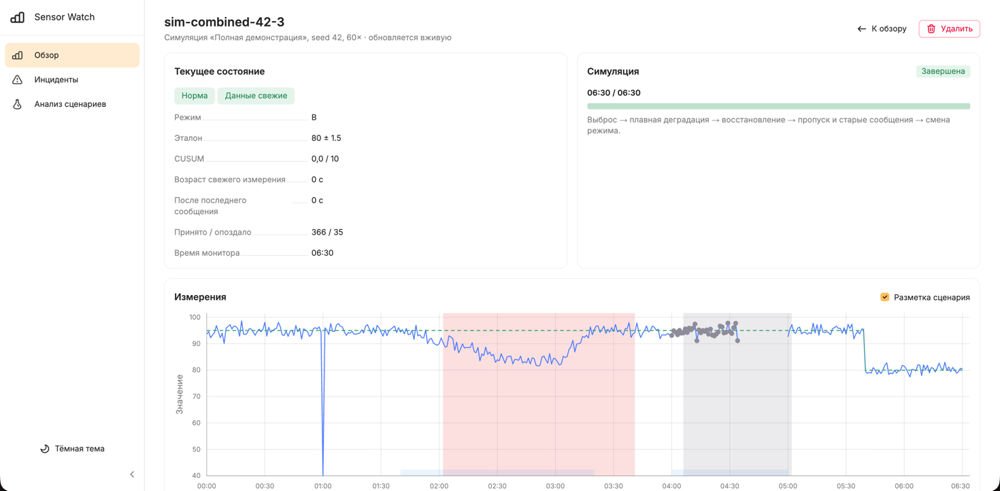

<div align="center">

# Sensor Watch

**Монитор качества и свежести сенсорных данных**


[Запуск](#запуск) · [Спецификации](docs/TECHNICAL-SPEC.md) · [API](gateway/README.md) · [Проверки](docs/DEVELOPMENT.md)

</div>

Sensor Watch обнаруживает устойчивое снижение показателя сенсора, потерю свежих данных и высокую долю невалидных измерений. Для каждого сенсора ведёт независимые статусы, инциденты и журнал причин решений.

Проект для кейса № 7 «Монитор дрейфа сенсоров и качества восприятия», Яндекс Студкемп 2026. В репозитории — FastAPI gateway, веб-интерфейс на React и автономная HTML-демонстрация. Проверка детектора построена на воспроизводимых синтетических сценариях.

## Возможности

- Приём телеметрии нескольких сенсоров через REST, обновления интерфейса через SSE.
- Обнаружение снижения качества: медианы временных окон, CUSUM и подтверждение тревоги.
- Раздельный контроль доставки и возраста измерений: старая пачка не закрывает потерю свежести.
- Эталоны известных режимов, обработка дублей, опозданий и невалидных значений.
- Живые симуляции, воспроизведение сценариев и пакетное сравнение с пороговым методом.

## Запуск

Нужны **Python 3.10+**, **Node.js 18+** и npm. Проверено на Python **3.12.12**, Node.js **20.10.0**, npm **10.2.3**. Для воспроизведения проверенного окружения используйте эти версии. Команды ниже — для macOS/Linux; Windows описан в [руководстве разработчика](docs/DEVELOPMENT.md).

```sh
git clone https://github.com/NilLev06/YandexStudCamp2026.git
cd YandexStudCamp2026
```

**Терминал 1 — gateway:**

```sh
cd gateway
python3 -m venv .venv
.venv/bin/python -m pip install -r requirements-dev.txt
.venv/bin/python -m uvicorn app.main:app --host 127.0.0.1 --port 8000
```

Проверьте `python3 --version` перед созданием окружения. Если установлено несколько версий, можно явно вызвать `python3.12 -m venv .venv`.

**Терминал 2 — интерфейс, из корня репозитория:**

```sh
cd frontend
npm ci
npm run dev
```

Откройте **http://localhost:5173**. Vite направляет `/api` на gateway. Выберите раздел «Один датчик» или «Несколько датчиков», затем сценарий и seed. Раздел «Анализ» показывает результаты проверки; вкладка «Тревоги» хранит историю рассчитанных симуляций.

## Новые кейсы в React

После запуска gateway и React доступны два раздела:

- `/single` — **Один датчик**: 15 воспроизводимых сценариев и восемь независимых тревог: отклонение уровня в обе стороны, повышенный разброс, подозрение на залипание, насыщение, снижение частоты, непригодные измерения (включая невозможные скачки), отсутствие свежих данных, высокая доля опоздавших сообщений. Каждая тревога содержит наблюдаемый признак, порог и условие подтверждения; восстановление записывается отдельно.
- `/pair` — **Несколько датчиков** (переключение 2 / 3): общая динамика, дрейф одного канала, одиночный выброс и пропуск со старой пачкой. Расхождение подтверждается одним окном 3 с с минимум тремя новыми синхронизированными парами; восстановление — двумя нормальными окнами подряд, всего 6 с. Монитор не определяет виновный источник.

Оба раздела используют FastAPI и React + Gravity UI, поддерживают seed, воспроизведение, перемещение по времени и журнал. Основной интерфейс работает с симуляциями: вкладка обзора и страницы реальных сенсоров убраны из маршрутов. В `/analysis` доступны полная демонстрация, 15 отдельных сценариев одного датчика и по 4 сценария для двух и трёх датчиков с актуальными правилами тревог. Сценарий и seed автоматически загружают расчёт; графики используют модельное время мин:с и синхронное наведение. Проверка на разных seed отдельно показывает обнаружения, пропуски, лишние тревоги вне заданных событий, повторные открытия, ранние снятия и незакрытые тревоги. Каждый прогон можно открыть в разборе. Вкладка «Тревоги» хранит последние 30 рассчитанных симуляций в браузере. Служебные API телеметрии сохранены для совместимости; исторические `/replays`, `/benchmark` и автономный `demo/index.html` используют прежний сравнительный алгоритм и не используются текущей вкладкой анализа.

В `/single` основной график показывает измерения и норму режима; медиана включается отдельно. Нижний график показывает CUSUM, разброс вынесен в числовой показатель. Медиана уровня считается в неперекрывающихся окнах 3 с. Для уровня используется двусторонний ограниченный CUSUM с параметрами исходного монитора: k=0.5, h=10, clip=4.5, подтверждение по одному текущему окну после достижения порога; восстановление — два нормальных окна подряд по 3 с и сброс накопления. Подтверждённое оба нормальных окна не закрашиваются красным; время решения о закрытии остаётся в журнале. Динамика и полнота оцениваются в окнах 3 с, открытие — одно нарушенное окно, закрытие — два нормальных окна подряд. Для разброса требуется минимум три пригодных измерения; два нормальных окна подряд могут закрыть тревогу до окончания всего шумного интервала. Для непригодных значений достаточно одного окна с долей ≥50% и минимум двумя сообщениями; восстановление — два нормальных окна подряд по 3 с. Свежесть восстанавливается по двум нормальным окнам подряд по 3 с с минимум шестью новыми пригодными измерениями. Старые сообщения не подтверждают восстановление. Невозможный скачок исключается из расчёта уровня и разброса и учитывается в доле непригодных сообщений.

Профиль `/single`: диапазон 0…100, допустимая скорость изменения 12 ед/с, ожидаемый период 1 с, нормы A: 70 ± 1 и B: 50 ± 1. Залипание имеет смысл только при ожидаемой динамике (настраиваемый `min_spread`, 0 отключает проверку). Насыщение и невозможная скорость требуют известных физических ограничений. Повышенный разброс не доказывает случайный шум; одиночный канал не устанавливает физическую причину изменения. Отдельная классификация квантования, ошибки масштаба и дрейфа нуля не реализована.

Проверки:

```sh
gateway/.venv/bin/python -m pytest gateway/tests
npm --prefix frontend run build
# Опционально: Playwright установлен, gateway запущен на 8010
node scripts/check-single-ui.cjs
node scripts/check-pair-ui.cjs
node scripts/check-chart-time-ui.cjs  # время оси и подсказки в трёх часовых поясах
```

Браузерные проверки также принимают `PLAYWRIGHT_MODULE` (путь к Playwright), `PAIR_BROWSER_PATH` (путь к браузеру), `SINGLE_DEMO_URL` / `PAIR_DEMO_URL`.

## Структура

API: **http://127.0.0.1:8000/docs**, схема: **http://127.0.0.1:8000/openapi.json**. [Отправка своей телеметрии и настройки](gateway/README.md).

### Один сервер после сборки

После установки зависимостей gateway, из корня репозитория:

```sh
cd frontend
npm ci
npm run build
cd ../gateway
.venv/bin/python -m uvicorn app.main:app --host 127.0.0.1 --port 8000
```

Gateway подхватывает `frontend/dist` при старте и раздаёт интерфейс на **http://127.0.0.1:8000**. Если сервер уже работал во время сборки, перезапустите его. Запускайте один процесс: состояние хранится в его памяти.

### Демонстрация без установки

Скачайте репозиторий и откройте [demo/index.html](demo/index.html) в браузере. Это готовый автономный файл: сервер и интернет не нужны. Он показывает один синтетический сенсор и не подключается к gateway.



Снимок относится к автономной демонстрации. Для короткого показа есть [сценарий выступления](demo/ЗАЩИТА.md).

## Документация

| Материал | Что внутри |
|---|---|
| [Техническая спецификация](docs/TECHNICAL-SPEC.md) | Архитектура, алгоритмы, параметры, структуры данных и сложность |
| [Backend-спецификация](docs/BACKEND-SPEC.md) | Контракты генератора, монитора, replay и оценщика |
| [Frontend-спецификация](docs/FRONTEND-SPEC.md) | Страницы, обновления, графики, автономное воспроизведение и сборка |
| [Схема Obsidian](docs/architecture.canvas) | Компоненты и связи в редактируемом Canvas |
| [Gateway и API](gateway/README.md) | Формат телеметрии, маршруты, SSE, ошибки, переменные окружения |
| [Разработка и проверка](docs/DEVELOPMENT.md) | Зависимости, Windows, сборка, тесты, сценарии и метрики |
| [Результаты валидации](docs/VALIDATION.md) | Воспроизводимый отчёт по сценариям, ступеням и моделям шума |

## Границы применения

Текущая версия использует синтетические данные, заранее заданные эталоны и согласованные часы. Автоматическая калибровка и подключение оборудования не реализованы. Сравнение с порогом иллюстративное, без выравнивания бюджета ложных тревог; результаты не доказывают пригодность для реального оборудования.

Реальные наборы данных не подключены. Gateway хранит состояние в памяти одного процесса.

В режиме трёх датчиков сравниваются A–B, A–C и B–C отдельными мониторами с теми же условиями 3 с / 6 с. Третий датчик C генерируется независимо, а данные A/B при переключении режима сохраняются. При согласованной паре и двух подтверждённых расхождениях третий источник отмечается как вероятный источник расхождения; это не доказательство неисправности. При потере одного источника сравнение оставшихся продолжается. Анализ содержит 25 сценариев, включая варианты `triple:*`; история различает режимы.

В режиме 3 датчиков доступен сценарий «Дрейф двух датчиков» (`triple:dual_drift`): B и C совместно смещаются, A остаётся нормальным. Он демонстрирует расхождение и ограничение большинства: согласованность двух источников не доказывает их исправность. Разметка виновных доступна только интерфейсу и оценщику, не монитору.

Gateway принимает внешнюю телеметрию, но готовых адаптеров оборудования и реальных наборов данных в проекте нет. Эталоны заданы в коде и общие для сенсоров; автоматической калибровки нет. Детектор отслеживает снижение значения и предполагает согласованные часы. При автокоррелированном шуме в проверке возникают ложные тревоги — [результаты и условия эксперимента](docs/VALIDATION.md).

Состояние теряется при перезапуске. База данных, внешние уведомления и разграничение доступа по пользователям не реализованы; опциональный API-ключ защищает только операции изменения сенсоров и симуляций. Сравнение с простым порогом иллюстративное: методы не настроены на одинаковый бюджет ложных тревог.
