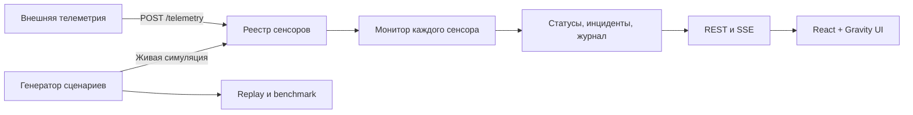

# Архитектура

[README](../README.md) · [Детектор](DETECTOR.md) · [API](../gateway/README.md) · [Разработка](DEVELOPMENT.md)

## Компоненты

| Каталог | Ответственность |
|---|---|
| `gateway/app/api/` | HTTP-маршруты, проверка запросов, SSE |
| `gateway/app/schemas.py` | Модели запросов и ответов OpenAPI |
| `gateway/app/registry.py` | Реестр, история, часы и жизненный цикл симуляций |
| `gateway/app/engine/` | Монитор, синтетические сценарии, оценка, рекомендации seed |
| `gateway/app/broker.py` | Рассылка обновлений подписчикам |
| `gateway/app/settings.py` | Настройки процесса |
| `frontend/src/` | React-приложение, HTTP-клиент, подписка SSE, графики |
| `demo/` | JS-движок и автономный интерфейс, сборка и валидация |

## Путь телеметрии

1. `POST /api/v1/telemetry` проверяет структуру пачки. Для неизвестного ID создаётся сенсор с отдельным `Monitor`.
2. Gateway назначает `received_at`, добавляет измерения в историю и очередь обработки. `202` подтверждает постановку в очередь; статус может ещё отсутствовать.
3. Фоновый такт забирает очередь каждого сенсора и вызывает `Monitor.tick(now, incoming)`. Пустая очередь тоже обрабатывается: потеря свежести обнаруживается без новых сообщений.
4. Монитор обновляет окна, CUSUM и независимые инциденты `quality`, `availability`, `flags`. Измерения сохраняются в истории до фильтрации монитором, поэтому дубль или позднее сообщение могут быть видны в истории, не участвуя в оценке.
5. Реестр сохраняет кадр статуса и журнал, затем публикует `update`: сводку и накопленные новые кадры, измерения и события. REST возвращает сохранённое состояние.

Все изменения реестра выполняются в одном цикле asyncio. `replays` и `benchmark` — синхронные обработчики в пуле потоков FastAPI; они создают собственные мониторы и не добавляют сенсоры в реестр.

## Время и симуляции

| Поле | Внешняя телеметрия (`clock: wall`) | Симуляция (`clock: virtual`) |
|---|---|---|
| `event_time` | Unix-время измерения, с | Секунды от начала сценария |
| `received_at`, `Frame.now` | Unix-время | Модельное время |
| Событие `time`, инцидент `start/end` | Unix-время | Модельное время |
| `created_at`, `wall_time`, `opened_at/closed_at`, `started_at` | Unix-время gateway | Unix-время gateway |

Такт по умолчанию — 1 реальная секунда. Для симуляции реестр проходит каждую модельную секунду до `floor((wall − started_at) × speed)`. Ускорение меняет длительность показа, сохраняя последовательность решений офлайн-воспроизведения.

Симуляция проходит состояния `running → finished` либо `running → stopped`. После остановки или завершения её монитор больше не тикает; последний статус и история сохраняются. Остановка не освобождает ID сенсора. Удаление сенсора удаляет также запись его симуляции. Внешняя телеметрия не может записывать данные в сенсор симуляции.

## Интерфейс

| URL | Назначение |
|---|---|
| `/` | Сенсоры, распределение статусов, открытые инциденты, запуск симуляции |
| `/sensors/:sensorId` | Значения и CUSUM, текущие статусы, журнал, инциденты, остановка и удаление |
| `/incidents` | Общий список с фильтрами по типу и состоянию |
| `/analysis` | Воспроизведение сценария, сравнение методов, пакетная проверка |

При загрузке клиент получает `/meta` с параметрами и сценариями. Обзор и карточка сенсора загружают REST-снимок и слушают SSE; обновления инцидентов инициируют повторную загрузку списка. Тема сохраняется в `localStorage`. Автономная демка — отдельный интерфейс: локальный replay, перемотка, проверка 250 прогонов и экспорт JSON.

## Хранение и доставка

- Всё состояние находится в памяти одного процесса. Несколько workers получат независимые реестры; перезапуск очищает данные.
- На сенсор по умолчанию сохраняются последние 3600 кадров, 3600 измерений и 2000 событий. Внутренние списки событий и инцидентов монитора ограничены `maxLog = 10000`.
- Дедупликация хранит ID по временным корзинам за горизонт 120 с. Ограничен горизонт, а не количество сообщений за секунду. Очередь принятых измерений до следующего такта и служебные отметки времени инцидентов не имеют отдельного лимита размера.
- На SSE-подписчика выделяется очередь из 256 сообщений; при переполнении отбрасывается самое старое. Поток не содержит SSE ID и не воспроизводит пропуски по `Last-Event-ID`. Для сверки состояния используйте REST; встроенный клиент не реализует полное восстановление пропущенной истории.

## Две реализации движка

[demo/engine.js](../demo/engine.js) содержит генератор, монитор и оценщик для браузера и Node.js. Python-порт находится в [gateway/app/engine](../gateway/app/engine/). Тесты сравнивают сообщения, кадры, события, инциденты и метрики двух реализаций. При изменении алгоритма нужно обновить обе стороны, пересобрать демку и повторить валидацию — [команды](DEVELOPMENT.md).
