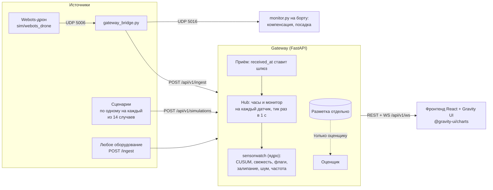
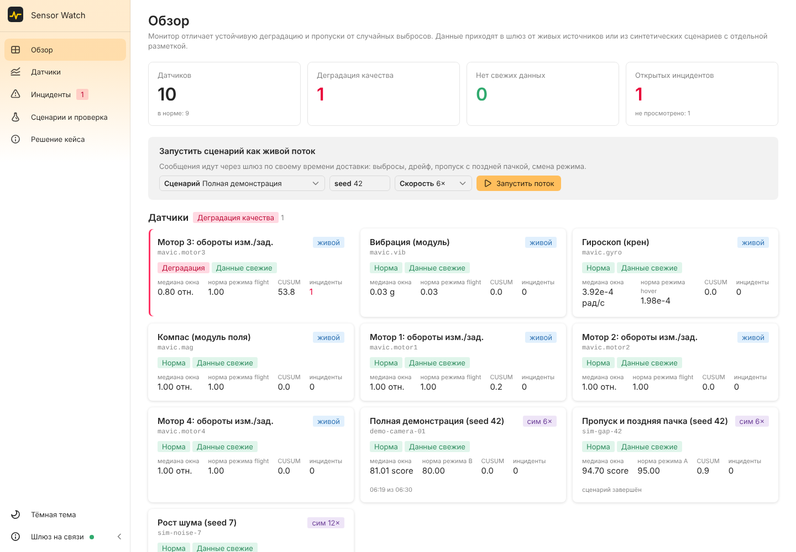
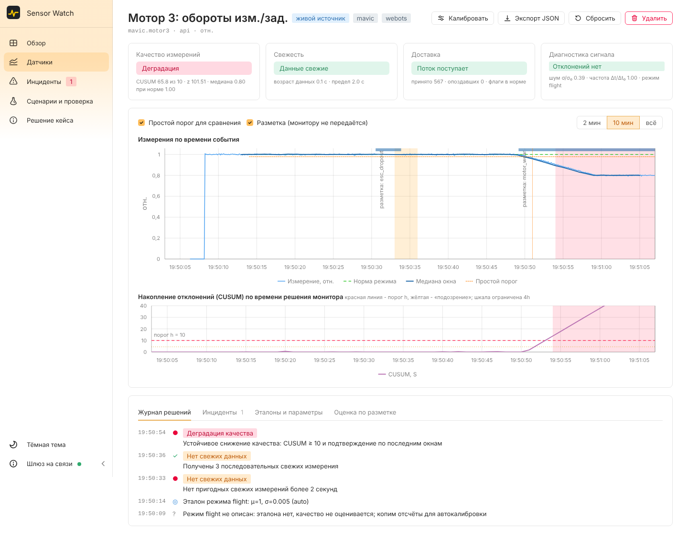
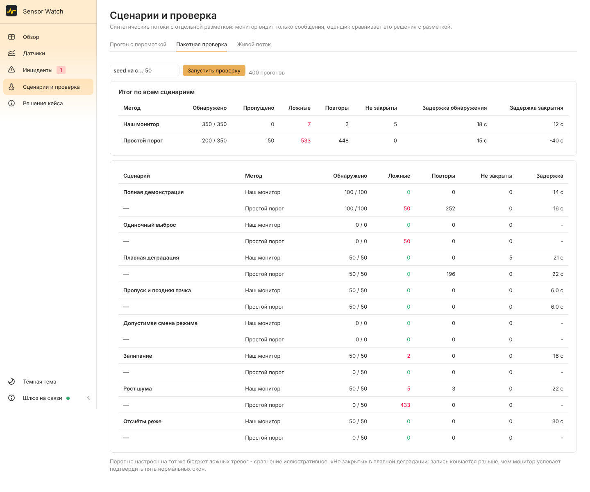

# Sensor Watch Gateway: архитектура и API

Ветка `feature/gateway` превращает автономное демо (`demo/`) в сервис: источники телеметрии шлют измерения
в шлюз на FastAPI, монитор работает по каждому датчику отдельно, интерфейс на React + Gravity UI смотрит
на всё вживую. Демо `demo/index.html` не тронуто и работает как раньше.







## Запуск одной командой

```sh
python -m pip install -r gateway/requirements.txt   # один раз
start_demo.bat                                      # Windows, двойной клик
python start_demo.py                                # то же из терминала
python start_demo.py --no-drone                     # только шлюз и интерфейс
python start_demo.py --phone http://192.168.1.5:8080 --webots "C:/Program Files/Webots/msys64/mingw64/bin/webotsw.exe"
```

Лаунчер поднимает шлюз (порт 8000), мост дрона, бортовой монитор, мост телефона и Webots с `sim/webots_drone/worlds/drift.wbt`,
открывает браузер и по Ctrl+C останавливает всё. Интерфейс: простой режим (`/`) и «Эксперт» (`/expert`).

## Запуск по частям (разработка)

```sh
# 1. Шлюз (Python 3.11+)
cd gateway
pip install -r requirements.txt
uvicorn app.main:app --reload --port 8000        # API и Swagger: http://localhost:8000/docs

# 2. Фронтенд (Node 18+), в другом терминале
cd frontend
npm install
npm run dev                                      # http://localhost:5173, /api проксируется на :8000
```

Для показа хватит одного процесса: `cd frontend && npm run build`, после этого шлюз сам отдаёт интерфейс на
http://localhost:8000. Или `docker compose up --build` (образ собирает фронтенд и запускает шлюз).

При старте шлюз сам запускает демо-датчик `demo-camera-01` (сценарий combined, ускорение 6×), чтобы
интерфейс не был пустым. Отключить: `SENSORWATCH_DEMO_ON_START=0`.

| Переменная | По умолчанию | Смысл |
|---|---|---|
| `SENSORWATCH_INGEST_KEY` | пусто | Если задан, `POST /ingest` требует заголовок `X-API-Key` |
| `SENSORWATCH_CORS_ORIGINS` | `*` | Разрешённые источники фронтенда |
| `SENSORWATCH_AUTO_CALIB_SAMPLES` | `30` | Автокалибровка нового датчика: столько отсчётов на режим |
| `SENSORWATCH_HISTORY` | `20000` | Сколько сообщений и кадров хранить на датчик (в памяти) |
| `SENSORWATCH_DEMO_ON_START` | `1` | Запускать демо-датчик при старте |

## Модель времени

- `event_time` - когда измерено (присылает источник: секунды epoch, модельные секунды или ISO 8601).
- `received_at` - когда пришло. **Ставит шлюз** по часам датчика, а не источник: так видны опоздания и старые пачки.
- У каждого датчика свои часы: `wall` (настенное время, живые источники) или `sim` (модельное время сценария с ускорением).
- Планировщик раз в 100 мс догоняет часы каждого датчика шагами по 1 с и вызывает `monitor.tick(now, пришедшее_к_now)`.
  Тик идёт и без входящих данных, иначе пропуск не заметить.

## API (`/api/v1`)

Полное описание со схемами: http://localhost:8000/docs.

| Метод | Путь | Что делает |
|---|---|---|
| GET | `/health` | Проверка живости |
| GET | `/meta` | Типы инцидентов, параметры монитора по умолчанию, сценарии |
| **POST** | **`/ingest`** | Принять пачку измерений (до 10 000); новый `sensor_id` регистрируется сам |
| WS | `/ws?sensor_id=...` | Живой поток: `hello`, `tick` (кадр + измерения + события), `sensor`, `sensor_removed`, `incident_ack` |
| GET | `/sensors` | Список датчиков со статусом (`?kind=live\|simulation`, `?tag=`) |
| POST | `/sensors` | Зарегистрировать датчик: паспортные эталоны режимов, параметры монитора |
| GET / PATCH / DELETE | `/sensors/{id}` | Карточка / изменить параметры (со следующего тика) / удалить |
| POST | `/sensors/{id}/reset` | Сбросить накопленное состояние, эталоны сохранить |
| GET | `/sensors/{id}/status` | Последний кадр монитора |
| GET | `/sensors/{id}/series` | Измерения (по времени события) и кадры (по времени решения) для графиков |
| GET | `/sensors/{id}/profiles` | Эталоны режимов и их источник (паспорт, ручной, калибровка, авто) |
| PUT | `/sensors/{id}/profiles/{mode}` | Задать эталон режима вручную |
| POST | `/sensors/{id}/calibrate` | Эталон по здоровому интервалу: медиана и 1.4826·MAD |
| GET / PUT | `/sensors/{id}/labels` | Разметка. Хранится отдельно, монитору не передаётся |
| GET | `/sensors/{id}/evaluation` | Инциденты против разметки: монитор и простой порог |
| GET | `/sensors/{id}/export` | Полная выгрузка в JSON |
| GET | `/incidents` | Инциденты (`?state=open\|closed`, `?type=`, `?sensor_id=`) |
| GET | `/incidents/{id}` | Один инцидент |
| POST | `/incidents/{id}/ack` | Оператор увидел. Закрывает инцидент только монитор |
| GET | `/events` | Журнал решений монитора по всем датчикам |
| GET | `/overview` | Сводка для главного экрана |
| GET | `/scenarios` | Сценарии |
| GET | `/scenarios/{id}/dataset?seed=` | Поток и разметка раздельно, как в постановке |
| POST / GET | `/runs`, `/runs/{id}` | Офлайн-прогон сценария: кадры, инциденты, метрики |
| POST | `/benchmark` | Пакетная проверка: сценарии × seed, монитор против порога |
| POST | `/simulations` | Проиграть сценарий через шлюз как живой датчик (`speed` - ускорение) |

### Примеры

```sh
# Отправить измерения (время события - ISO или секунды)
curl -X POST localhost:8000/api/v1/ingest -H 'Content-Type: application/json' -d '{
  "messages": [
    {"sensor_id": "lab.thermo-01", "event_time": "2026-10-27T19:00:00+03:00", "value": 21.4, "mode": "heating"},
    {"sensor_id": "lab.thermo-01", "event_time": "2026-10-27T19:00:01+03:00", "value": null, "quality_flags": "sensor_error"}
  ]}'

# Зарегистрировать датчик с паспортной нормой и деградацией в обе стороны
curl -X POST localhost:8000/api/v1/sensors -H 'Content-Type: application/json' -d '{
  "id": "line.pressure-3", "unit": "бар",
  "profiles": {"run": {"mean": 4.2, "sigma": 0.05}, "idle": {"mean": 0, "sigma": 1, "assess": false}},
  "config": {"direction": "both", "stale_after": 10}}'

# Загрузить разметку для оценки (монитор её не видит)
curl -X PUT localhost:8000/api/v1/sensors/line.pressure-3/labels -H 'Content-Type: application/json' \
  -d '[{"start": 1793116800, "end": 1793117100, "type": "quality", "label": "засор фильтра"}]'

# 800 прогонов: 16 сценариев × 50 seed
curl -X POST localhost:8000/api/v1/benchmark -H 'Content-Type: application/json' -d '{"seeds": 50}'
```

## Ядро `gateway/sensorwatch`

Чистый Python без веб-зависимостей, можно использовать отдельно:

```python
from sensorwatch import replay, evaluate, benchmark, Monitor, MonitorConfig, Profile
r = replay("drift", seed=42)
print(evaluate(r)["monitor"])     # {'detected': 1, 'false_alarms': 0, 'delay': ...}
```

- **Совместимость с демо.** Генератор (тот же mulberry32), монитор, порог и оценщик повторяют `demo/engine.js`
  бит в бит: тест `test_parity_with_engine_js` сравнивает данные, инциденты, события и S на каждом шаге.
- **Расширения** (по умолчанию включены, на исходных сценариях не срабатывают):
  - `direction`: деградация вниз (score), вверх или в обе стороны (двусторонний CUSUM);
  - автокалибровка эталона неизвестного режима (`calib_samples`), режимы «только свежесть» (`assess: false`);
  - диагностика окна: залипание (размах 0 несколько окон подряд), рост шума (σ по разностям соседних
    отсчётов, тренд не мешает), частота отсчётов (Δt/Δt₀, Δt₀ меряется онлайн);
  - во время залипания CUSUM на паузе, при росте шума z нормируется на фактический шум.

### Проверка: 14 случаев документа × 50 seed

Каждый из 14 случаев документа ловит детектор своей группы (отдельных детекторов нет). У каждого случая
свой сценарий с отдельной разметкой. В интерфейсе это кнопки случаев внутри группы.

| Случай | Группа: чем ловим | Сценарий | Найдено из 50 | Ложных | Задержка, с |
|---|---|---|---|---|---|
| 1 Скачок | 1: медиана окна, тревоги нет | spike | тревог 0 (порог: 50 ложных) | 0 | - |
| 2 Ступенька | 2: CUSUM, форма «ступенька» | step | 50 | 0 | 9.8 |
| 3 Дрейф | 2: CUSUM, форма «дрейф» | drift | 50 | 0 | 21.4 |
| 4 Дрейф нуля | 2: CUSUM | bias | 50 | 0 | 36.0 |
| 5 Масштаб | 7: CUSUM по y/ŷ | gain | 50 | 0 | 9.9 |
| 6 Залипание | 5: размах окна 0 | stuck | 50 | 2 | 16.0 |
| 7 Рост шума | 6: σ окна по разностям | noise | 50 | 5 | 21.9 |
| 8 Насыщение | 5: размах окна 0 | saturation | 50 | 0 | 16.0 |
| 9 Пропуск | 3: таймер свежести | gap | 50 | 0 | 6.0 |
| 10 Частота | 3: медиана Δt / Δt0 | rate | 50 | 0 | 30.0 |
| 11 Задержка | 3: таймер свежести + watermark | latency | 50 | 0 | 2.0 |
| 12 Квантование | 5: размах окна 0 | quant | 49 | 1 | 26.3 |
| 13 Периодическая помеха | 6: σ окна по разностям | periodic | 50 | 0 | 20.6 |
| 14 Расхождение | 7: CUSUM по невязке y2 - y1 | pair | 50 | 0 | 26.3 |

Плюс исходные combined и mode: 100/100, 0 ложных. Всего 749 из 750 при 8 ложных.
Форма ухода в группе 2 (ступенька или дрейф) подписывается через 6 окон после тревоги и на 50 seed верна во всех прогонах.
Отсчёты со временем события позже приёма больше чем на `max_future` = 5 с отбрасываются (часы датчика спешат).



Тесты: `cd gateway && pytest` (35 тестов; сверка с `engine.js` требует Node.js).

## Дрон как живой источник

См. `sim/webots_drone/README.md`. Бортовой `monitor.py` по-прежнему спасает дрон (компенсация износа мотора,
посадка при дрейфе гироскопа), а `gateway_bridge.py` превращает каналы дрона в датчики шлюза
`mavic.gyro`, `mavic.mag`, `mavic.vib`, `mavic.motor1..4` и выгружает разметку сценария отдельно.
