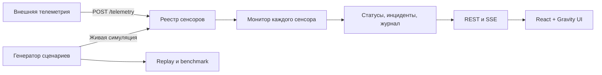
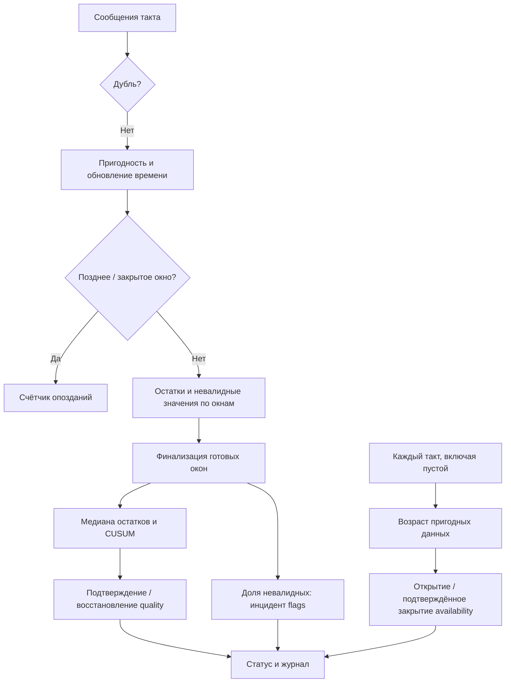

# Техническая спецификация — Sensor Watch

[README](../README.md) · [Backend](BACKEND-SPEC.md) · [Frontend](FRONTEND-SPEC.md) · [Разработка](DEVELOPMENT.md)

Кейс № 7: монитор дрейфа сенсоров и качества восприятия. Спецификация описывает текущие сервер, движок и автономную демонстрацию.

## Компоненты



| Каталог | Ответственность |
|---|---|
| `gateway/app/api/` | HTTP-маршруты, проверка запросов, SSE |
| `gateway/app/schemas.py` | Модели запросов и ответов OpenAPI |
| `gateway/app/registry.py` | Реестр, история, часы и жизненный цикл симуляций |
| `gateway/app/engine/` | Монитор, синтетические сценарии, оценка, рекомендации seed |
| `gateway/app/broker.py` | Рассылка обновлений подписчикам |
| `gateway/app/settings.py` | Настройки процесса |
| `frontend/src/` | React-приложение, HTTP-клиент, подписка SSE, графики |
| `demo/` | JS-движок и автономный интерфейс, сборка и валидация |

## Путь телеметрии

1. `POST /api/v1/telemetry` проверяет структуру пачки. Для неизвестного ID создаётся сенсор с отдельным `Monitor`.
2. Gateway назначает `received_at`, добавляет измерения в историю и очередь обработки. `202` подтверждает постановку в очередь; статус может ещё отсутствовать.
3. Фоновый такт забирает очередь каждого сенсора и вызывает `Monitor.tick(now, incoming)`. Пустая очередь тоже обрабатывается: потеря свежести обнаруживается без новых сообщений.
4. Монитор обновляет окна, CUSUM и независимые инциденты `quality`, `availability`, `flags`. Измерения сохраняются в истории до фильтрации монитором, поэтому дубль или позднее сообщение могут быть видны в истории, не участвуя в оценке.
5. Реестр сохраняет кадр статуса и журнал, затем публикует `update`: сводку и накопленные новые кадры, измерения и события. REST возвращает сохранённое состояние.

Все изменения реестра выполняются в одном цикле asyncio. `replays` и `benchmark` — синхронные обработчики в пуле потоков FastAPI; они создают собственные мониторы и не добавляют сенсоры в реестр.

## Время и симуляции

| Поле | Внешняя телеметрия (`clock: wall`) | Симуляция (`clock: virtual`) |
|---|---|---|
| `event_time` | Unix-время измерения, с | Секунды от начала сценария |
| `received_at`, `Frame.now` | Unix-время | Модельное время |
| Событие `time`, инцидент `start/end` | Unix-время | Модельное время |
| `created_at`, `wall_time`, `opened_at/closed_at`, `started_at` | Unix-время gateway | Unix-время gateway |

Такт по умолчанию — 1 реальная секунда. Для симуляции реестр проходит каждую модельную секунду до `floor((wall − started_at) × speed)`. Ускорение меняет длительность показа, сохраняя последовательность решений офлайн-воспроизведения.

Симуляция проходит состояния `running → finished` либо `running → stopped`. После остановки или завершения её монитор больше не тикает; последний статус и история сохраняются. Остановка не освобождает ID сенсора. Удаление сенсора удаляет также запись его симуляции. Внешняя телеметрия не может записывать данные в сенсор симуляции.

## Хранение и доставка

- Всё состояние находится в памяти одного процесса. Несколько workers получат независимые реестры; перезапуск очищает данные.
- На сенсор по умолчанию сохраняются последние 3600 кадров, 3600 измерений и 2000 событий. Внутренние списки событий и инцидентов монитора ограничены `maxLog = 10000`.
- Дедупликация хранит ID по временным корзинам за горизонт 120 с. Ограничен горизонт, а не количество сообщений за секунду. Очередь принятых измерений до следующего такта и служебные отметки времени инцидентов не имеют отдельного лимита размера.
- На SSE-подписчика выделяется очередь из 256 сообщений; при переполнении отбрасывается самое старое. Поток не содержит SSE ID и не воспроизводит пропуски по `Last-Event-ID`. Для сверки состояния используйте REST; встроенный клиент не реализует полное восстановление пропущенной истории.

## Алгоритмы монитора

Реализации: [JavaScript](../demo/engine.js) и [Python](../gateway/app/engine/monitor.py). Монитор получает текущее время и сообщения очередного такта; разметка событий ему не передаётся. Большое значение показателя считается хорошим, устойчивое снижение — деградацией.



### Приём и окна

1. Дубли определяются внутри корзины `floor(event_time / 3)` по `id`, а при его отсутствии — по `event_time`. Горизонт хранения корзин — 120 с. Повтор не обновляет счётчик принятых сообщений и время последнего приёма.
2. Пригодно конечное числовое значение с флагом `valid` (в самом движке допустим и отсутствующий флаг). `null` или другой флаг исключают значение из анализа качества.
3. Для пригодного сообщения обновляется самое новое время измерения, даже если оно затем признано поздним. Возраст считается от этого времени, а не от доставки.
4. Сообщение исключается из текущего анализа, если `now − event_time > 5 с` либо его корзина уже закрыта. Оно увеличивает `late_count` и не меняет режим. Поздние невалидные сообщения также не учитываются в доле плохих флагов.
5. Окна неперекрывающиеся, длиной 3 с. Окно закрывается через 2 с после его правой границы. Пустые окна не создают статистику. Для оценки качества нужны минимум два пригодных значения известного режима.

### Нормирование и CUSUM

Эталоны заданы в `PROFILES`, одинаковы для всех сенсоров:

| Режим | Среднее μ | σ |
|---|---:|---:|
| A | 95 | 1,5 |
| B | 80 | 1,5 |

Каждое значение сначала нормируется своим режимом: `r = (μ − value) / σ`. Для окна из `n` пригодных значений:

```text
z = median(r) / medianSd(n)
S = max(0, S + clamp(z, −4.5, 4.5) − 0.5)
```

`medianSd` использует таблицу для n = 2…8: `0.7071, 0.6702, 0.5467, 0.5352, 0.4635, 0.4588, 0.4107`; для n ≥ 9 — `sqrt(π / (2n))`. Это оценка стандартного отклонения медианы независимого нормального шума.

В кадре `s` — накопление S, `z` — последняя стандартизованная медиана. `aggregate` переводит медиану остатков обратно в шкалу последнего известного режима окна; при смешении режимов это не медиана исходных значений. `aggregate_time` равен `(bucket + 1) × 3 − 1`.

#### Инцидент качества

- Открытие: `S ≥ 10` и как минимум два из последних трёх рассчитанных `z > 1.2`.
- Закрытие: последние пять рассчитанных окон имеют `|z| < 1.35`. После закрытия обнуляются S, история z и агрегат.
- Известная смена режима сохраняет накопление и открытый инцидент; восстановление проверяется по нормированным остаткам.
- Неизвестный режим фиксируется событием `unknown_mode`. Его значения не входят в статистику качества; пригодное измерение при этом может подтверждать свежесть. Старый агрегат и открытая тревога сохраняются, поэтому `mode_known = false` не обязательно немедленно меняет `quality` на `unknown`.

«Пять окон» — последние рассчитанные окна с достаточным числом значений: пропуски сами по себе не добавляют z и не сбрасывают эту историю. Журнал известных переключений ограничен одной записью за 30 с; число пропущенных переключений включается в следующую запись.

### Свежесть

`age = now − newest_valid_event_time`. Если пригодного сообщения ещё не было или `age > 6 с`, данные устарели. Инцидент `availability` открывается на такте с устаревшими данными при `now > 6`.

Для внешней телеметрии `now` — Unix-время: у нового сенсора без пригодных данных инцидент может открыться уже на первом такте. У симуляций время начинается с нуля.

Закрытие требует **трёх последовательных тактов**, на каждом из которых есть хотя бы одно пригодное входящее сообщение возрастом не больше 2 с и данные не считаются устаревшими. Три измерения в одной пачке дают одно подтверждение. Условие проверяется по исходному входу такта, включая дубли. При закрытии обнуляются S и история z; открытый инцидент качества автоматически не закрывается.

`since_receipt` показывает время с последнего недублирующегося сообщения, в том числе невалидного или старого. Поэтому доставка может работать одновременно с тревогой свежести.

### Невалидные измерения

Для закрываемого окна знаменатель — число пригодных значений известных режимов плюс число невалидных сообщений. При знаменателе ≥ 2 и доле невалидных ≥ 50% открывается `flags`. Он закрывается после трёх обработанных окон с долей ниже порога. Окна с меньшим знаменателем не подтверждают и не сбрасывают восстановление. Пригодные значения неизвестного режима в знаменатель не входят.

Этот инцидент независим от качества и свежести. Если приходят только невалидные значения, могут одновременно открыться `flags` и `availability`.

### Статусы кадра

| Поле | Значение | Условие |
|---|---|---|
| `quality` | `alarm` | Открыт инцидент качества; приоритет выше остальных условий |
| | `unknown` | Нет агрегата, его возраст > 8 с, данные устарели или открыт `availability` |
| | `suspect` | Оценка доступна и S > 4,5 |
| | `normal` | Оценка доступна и S ≤ 4,5 |
| `availability` | `stale` | Открыт инцидент доступности или возраст > 6 с |
| | `unknown` | Ещё нет пригодного измерения и инцидент не открыт |
| | `fresh` | Остальные случаи |
| `flags` | `degraded` / `ok` | Есть / нет открытого инцидента флагов |

## Параметры CONFIG и PROFILES

Значения доступны через `GET /api/v1/meta`. HTTP API изменения параметров и эталонов нет.

| Параметры `CONFIG` | Значения | Назначение |
|---|---|---|
| `bucket`, `lateness` | 3, 2 с | Окна и ожидание опозданий |
| `staleAfter`, `freshAgeThreshold`, `freshConfirm` | 6 с, 2 с, 3 | Потеря свежести и восстановление |
| `k`, `h`, `clip`, `suspect` | 0,5; 10; 4,5; 4,5 | CUSUM |
| `confirmZ`, `recoverZ` | 1,2; 1,35 | Подтверждение и восстановление качества |
| `badFlagShare`, `flagsRecover` | 0,5; 3 | Невалидные измерения |
| `dedupWindow`, `modeLogEvery`, `maxLog` | 120 с; 30 с; 10000 | Память дублей и журнал |
| `matchTolerance`, `baselineSigma` | 3 с; 4,5 | Только оценщик и пороговый метод |

Детектор не оценивает рост показателя как неисправность, не обучает эталоны и не компенсирует корреляцию шума. Численные результаты и границы экспериментов — в [отчёте валидации](VALIDATION.md).

## Структуры данных и сложность

W — число измерений в одном окне, B — число накопленных окон, D — число ключей дедупликации в горизонте 120 с, L — размер журнала. Трёхсекундное окно не ограничивает W тремя сообщениями: это верно лишь для генератора с частотой 1 Гц.

| Операция | Структура | Стоимость |
|---|---|---|
| Поиск окна / дубля | JS Map/Set, Python dict/set | В среднем O(1) на поиск и вставку |
| Завершение окон | Сортировка номеров готовых корзин | O(B log B) плюс обработка значений |
| Медиана | Сортировка копии массива остатков | O(W log W), временная память O(W) |
| CUSUM и подтверждение | S и последние 5 значений z | O(1) на рассчитанное окно |
| Очистка дедупликации | Просмотр временных корзин | Линейно по числу хранимых корзин |
| События и инциденты движка | Массив / список, максимум 10000 | При вытеснении первого элемента — O(L) |
| Истории gateway | `deque(maxlen=...)` | O(1) добавление и вытеснение |

При ограниченных частоте и размере истории проход монитора растёт линейно с числом тактов и сообщений. Для произвольной частоты следует учитывать сортировки окон и обслуживание буферов. Горизонт дедупликации ограничивает время хранения, а не число ключей D.

Генератор хранит и сортирует N сообщений по `(received_at, event_time)`: до O(N log N) времени, O(N) памяти. Replay дополнительно сохраняет T кадров и имеет память O(N + T + I + E), где I и E — сохранённые инциденты и события. Benchmark выполняет replay последовательно и накапливает метрики; память полного результата одного прогона всё равно нужна.

Измерений производительности с воспроизводимым стендом в репозитории нет. Время `elapsed_ms` в ответе benchmark — длительность конкретного запроса, а не гарантия пропускной способности.

## Соответствие кейсу

| Требование | Текущая реализация |
|---|---|
| Не объявлять деградацию по одному выбросу | Медиана остатков, ограничение вклада и подтверждение 2 из 3 окон |
| Обнаруживать устойчивое снижение | Односторонний CUSUM с h = 10 |
| Подтверждать восстановление | Пять рассчитанных окон с `abs(z) < 1.35` |
| Обнаруживать отсутствие свежих данных | Независимый таймер, работающий без входящих сообщений |
| Не закрывать потерю свежести старой пачкой | Три последовательных такта с пригодными сообщениями возрастом ≤ 2 с |
| Учитывать режим | Отдельные эталоны A/B без сброса накопления при переключении |
| Контролировать невалидные значения | Независимый инцидент `flags` по доле в окне |
| Воспроизводить и оценивать решения | Генератор с seed, replay, отдельная разметка и оценщик |

Численные результаты — в [отчёте](VALIDATION.md), контракты движка — в [backend-спецификации](BACKEND-SPEC.md), отображение — во [frontend-спецификации](FRONTEND-SPEC.md).
